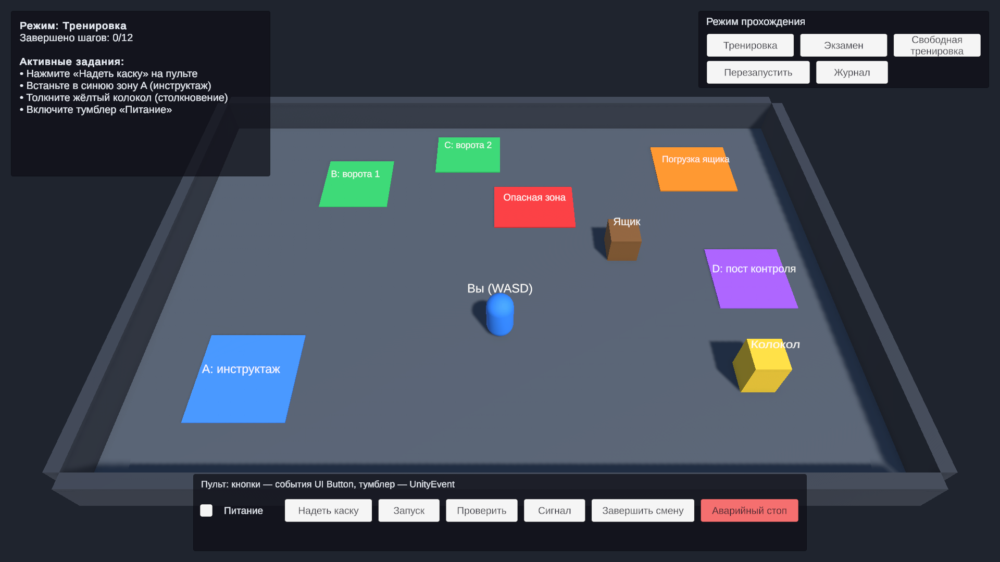
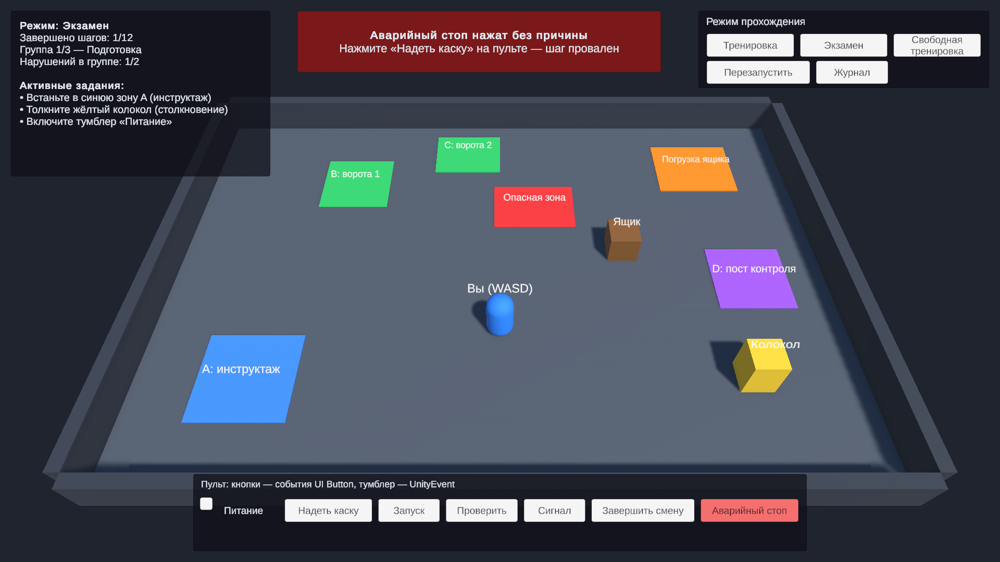
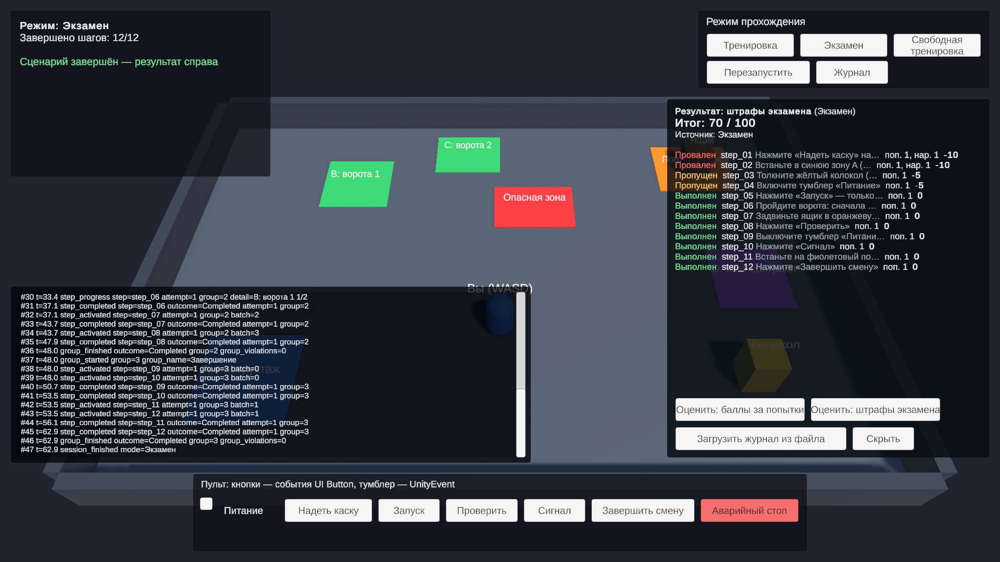

# Конструктор учебных сценариев

Unity 6000.6.4f1 (URP), C#. Сторонние ассеты и фреймворки не используются — только стандартные пакеты Unity (uGUI + TextMeshPro, Input System, Test Framework).

Сценарий собирается из переиспользуемых шагов прямо в Unity Editor. Одни и те же шаги проходятся в разных режимах (тренировка, экзамен, свободная тренировка), пишутся в структурированный журнал и оцениваются сменными анализаторами — в том числе повторно, по уже сохранённому журналу.



**Содержание:** [1. Быстрый старт](#1-быстрый-старт) · [2. Демо-сценарий](#2-демонстрационный-сценарий) · [3. Инструкция без программирования](#3-инструкция-для-того-кто-собирает-сценарий-без-программирования) · [4. Техническое описание](#4-техническое-описание) · [5. Соответствие ТЗ](#5-соответствие-требованиям-тз) · [6. Частые вопросы](#6-частые-вопросы-и-проблемы) · [7. Что улучшил бы дальше](#7-что-улучшил-бы-дальше) · [8. Затраченное время](#8-затраченное-время)

---

## 1. Быстрый старт

1. Открыть проект в Unity **6000.6.4f1**.
2. Открыть сцену `Assets/Scenes/LessonDemo.unity`.
3. Нажать **Play**. Сразу стартует режим «Тренировка».

Управление в демо:

| Что | Как |
|---|---|
| Двигаться | `W A S D` или стрелки |
| Кнопки пульта, тумблер «Питание» | мышью, панель внизу экрана |
| Выбрать режим / перезапустить | панель справа сверху |
| Журнал событий | кнопка «Журнал» |
| Переоценить результат | кнопки «Оценить: …» на панели результата |
| Загрузить последний журнал с диска и оценить | «Загрузить журнал из файла» |

Слева сверху — активные задания, текущая группа и счётчик нарушений. Красная плашка сверху — сообщение о нарушении с причиной. После завершения справа появляется результат.

| Нарушение в экзамене | Результат и журнал |
|---|---|
|  |  |

Если сцена испорчена или удалена: меню **Lesson Constructor → Build Demo Scene** собирает её заново (вместе с ассетами настроек в `Assets/App/Content`).

---

## 2. Демонстрационный сценарий

12 шагов, все объекты — примитивы и стандартный UI.

| Шаг | Задание | Тип шага | Источник события | Нарушение |
|---|---|---|---|---|
| step_01 | Нажать «Надеть каску» | Action | UI Button | «Аварийный стоп» |
| step_02 | Встать в синюю зону A | Action | Trigger | вход в опасную зону |
| step_03 | Толкнуть жёлтый колокол | Action | **Collision** | — |
| step_04 | Включить тумблер «Питание» | Action | **UnityEvent** (Toggle → StateFlag → UnityEventSource) | — |
| step_05 | Нажать «Запуск» **только при включённом питании** | StateGuarded (контекст) | UI Button + состояние объекта | «Запуск» без питания, «Аварийный стоп» |
| step_06 | Пройти **сначала зону B, затем C** | Sequence (контекст) | два Trigger | зона C раньше B, опасная зона |
| step_07 | Задвинуть ящик в зону погрузки | Action | Trigger, фильтр — только ящик | опасная зона |
| step_08 | Нажать «Проверить» | Action | UI Button | «Аварийный стоп» |
| step_09 | Выключить тумблер «Питание» | Action | UnityEvent | — |
| step_10 | Нажать «Сигнал» | Action | UI Button | «Аварийный стоп» |
| step_11 | Встать на пост D **при выключенном питании** | StateGuarded (контекст) | Trigger + состояние объекта | питание включено, опасная зона |
| step_12 | Нажать «Завершить смену» | Action | UI Button | «Аварийный стоп» |

Режимы используют **одни и те же 12 объектов шагов**:

| Режим | Группы и активация |
|---|---|
| Тренировка | одна группа: `[1 2 3 4] → [5] → [6] → [7] → [8] → [9 10] → [11 12]` — ровно пример из задания |
| Экзамен | «Подготовка» `[1 2 3 4]`, «Запуск» `[5] → [6] → [7] → [8]`, «Завершение» `[9 10] → [11 12]`; порог — 2 нарушения |
| Свободная тренировка | одна группа, все 12 шагов активны сразу; действия вне очереди игнорируются |

### Контрольные примеры

Все примеры из раздела 7 задания покрыты EditMode-тестами (`Assets/App/Tests/Edit`, 17 тестов) и воспроизводятся в сцене.

**Тренировка: 10 + 5 + 0 = 15.** В первой пачке шагов: включить «Питание» (step_04, с первой попытки — 10); зайти в опасную зону, затем в зону A (step_02, со второй — 5); дважды нажать «Аварийный стоп», затем «Надеть каску» (step_01, с третьей — 0).

**Экзамен: 70.** В группе «Подготовка» нажать «Аварийный стоп» (step_01 → Failed) и зайти в опасную зону (step_02 → Failed). Порог 2 достигнут: step_03 и step_04 получают Skipped, стартует группа «Запуск». Штраф группы 20 + 10 = 30. Если дальше пройти всё без ошибок, итог — 70.

**Смешанная активация.** В тренировке шаги 1–4 выполняются в любом порядке, затем по очереди открываются 5, 6, 7, 8, потом пачка 9 + 10 и пачка 11 + 12.

**Смена режима и анализатора без дублирования шагов.** Шаги лежат в `Scenario/Steps`, режимы на них только ссылаются. Анализатор режима меняется полем `Analyzer`, переоценка — кнопками на панели результата.

---

## 3. Инструкция для того, кто собирает сценарий (без программирования)

Всё настраивается в иерархии сцены `LessonDemo`:

```
Scenario            — ScenarioRunner: список режимов, логгеры, анализаторы
  Modes             — по объекту на режим (ScenarioMode)
Steps               — шаги (по объекту на шаг)
Power               — состояние «Питание» (StateFlag) и его события
World               — зоны (Trigger), колокол (Collision), ящик
HUD                 — окна интерфейса (MVVM) и кнопки пульта (UI Button)
```

### Изменить порядок и активацию шагов

1. Выбрать режим: `Scenario/Modes/Mode: Тренировка`.
2. В `Groups → <группа> → Steps` каждая строка — это шаг и способ активации:
   - **After Previous** — шаг откроется, когда завершены все шаги выше в этой группе;
   - **Together With Previous** — шаг откроется вместе со строкой выше.
3. Строки перетаскиваются за левый край — так меняется порядок.
4. Внизу инспектора — **Activation preview**: итоговые пачки вида `[step_01, step_02] → [step_05]`. Там же жёлтым подсвечиваются ошибки: пустые слоты, повтор шага, нет политики.

Примеры: все шаги одновременно — у всех строк, кроме первой, «Together With Previous». Строго последовательно — у всех «After Previous».

### Группы экзамена

Это отдельный список `Groups` у режима экзамена. Добавить группу — «+» в `Groups`, затем перетащить в её `Steps` объекты шагов из `Steps`. Группы идут по очереди. Наборы одновременно активных шагов внутри группы задаются тем же полем активации. Шаг в разных режимах может стоять в разных группах и в разном порядке: режим хранит только ссылку на шаг.

### Режим прохождения

- Какой режим стартует при Play: `Scenario → Default Mode Index` (0 — первый в списке `Modes`). Остальные запускаются кнопками на экране или в инспекторе `Scenario` в Play Mode.
- Правила режима — поле `Policy`:
  - `Assets/App/Content/Config/TrainingPolicy` — при нарушении шаг повторяется, группа не обрывается;
  - `Assets/App/Content/Config/ExamPolicy` — ошибочный шаг получает Failed; поле **Violation Limit** — порог нарушений в группе (по умолчанию 2, 0 — без порога).
- **Out Of Turn** — что делать с действием шага, чья очередь ещё не пришла: `Record Violation` (по умолчанию — засчитать нарушение) или `Ignore` (шаг не принимает действия до своей очереди).
- Новый режим: скопировать объект режима (Ctrl+D), поменять название, группы, политику и добавить его в `Scenario → Modes`. Шаги копировать не нужно.

### Обработка событий (что считается выполнением и нарушением)

Выбрать шаг в `Steps`:

- `Step Id` — идентификатор (попадает в журнал), `Instruction` — текст задания на экране;
- `Violation Sources` — действия, которые считаются нарушением этого шага, и `Violation Message` — текст причины;
- поля типа шага:
  - **Action Step** — `Action`: одно действие выполняет шаг;
  - **Sequence Step** — `Sequence`: действия в строгом порядке; действие из списка раньше времени — нарушение «порядок»;
  - **State Guarded Step** — `Action` засчитывается, только если `Required State` равен `Required Value`, иначе нарушение с текстом `Wrong State Message`.

Источник действия — любой объект с компонентом-источником:

| Компонент | Когда срабатывает | Настройка |
|---|---|---|
| `Button Event Source` | клик по UI Button на этом объекте | — |
| `Trigger Event Source` | объект вошёл в коллайдер-триггер | `Actor`: конкретный объект (`Required Object`) и/или тег (`Required Tag`) |
| `Collision Event Source` | столкновение с коллайдером | `Actor`, `Minimum Impact Speed` |
| `Unity Event Source` | вызов метода `Emit()` из любого UnityEvent | подключается в инспекторе любого UnityEvent (Toggle, Slider, свой компонент) |

Новое действие в сцене: добавить объект (кнопку, зону), повесить источник и перетащить его в поле шага.

Новый шаг: создать пустой объект в `Steps` → Add Component → `Action Step` / `Sequence Step` / `State Guarded Step` → заполнить поля → добавить шаг в группы нужных режимов.

### Логгер и анализатор

- **Логгеры** — `Scenario → Loggers`, можно несколько одновременно:
  - `JsonFileLogger` — файл `.jsonl` на прогон в `%USERPROFILE%/AppData/LocalLow/DefaultCompany/LessonConstructor/ScenarioJournals`; папка задаётся полем `Folder Name`;
  - `ConsoleLogger` — каждая запись в консоль Unity.
- **Анализатор режима** (оценка в конце) — поле `Analyzer` у режима:
  - `AttemptScoreAnalyzer` — баллы за попытки (10 / 5 / 0, значения редактируются);
  - `PenaltyAnalyzer` — 100 минус штрафы (Failed −10, Skipped −5, редактируются).
- **Анализаторы для переоценки** — `Scenario → Analyzers`, для каждого на экране результата появляется кнопка «Оценить: …».

Любой анализатор применим к журналу любого режима: оба читают один и тот же формат журнала.

### Посмотреть журнал и результат, оценить повторно

- Во время прохождения — кнопка «Журнал».
- После прохождения — панель результата: статус, попытки, нарушения и баллы по каждому шагу; при нехватке данных — жёлтые предупреждения.
- Повторная оценка без нового прохождения:
  - в Play Mode — кнопки «Оценить: …» или «Загрузить журнал из файла»;
  - без Play Mode — меню **Lesson Constructor → Journal Analyzer**: выбрать файл (`Latest` — последний), выбрать анализатор, `Analyze`.

---

## 4. Техническое описание

### Слои

```
App.Presentation ──► App.Infrastructure ──► App.Domain
        ▲
    App.Editor
```

| Сборка | Unity | Ответственность |
|---|---|---|
| `App.Domain` (`Assets/App/Code/Domain`) | нет (`noEngineReferences`) | план сценария, движок прохождения, политики режимов, контракт журнала, анализаторы |
| `App.Infrastructure` | нет | запись и чтение журнала в JSON Lines |
| `App.Presentation` | да | компоненты сцены: источники событий, шаги, режимы, раннер, HUD, ассеты настроек |
| `App.Editor` | Editor | инспекторы, окно анализа журнала, сборщик демо-сцены |
| `App.Tests.Edit` | Editor | EditMode-тесты Domain и Infrastructure |

### Основные части

- **`ScenarioPlan`** — группы → пачки → id шагов. Строится режимом из списка «шаг + активация» (`PlanGroup.FromSequence`). Проверяет, что шаг в режиме один раз.
- **`ScenarioSession`** — машина состояний прохождения: `Pending → Active → Completed | Failed | Skipped`. Открывает пачки и группы, считает попытки и нарушения группы, пишет каждое событие в `IScenarioLogger`. Ничего не знает об Unity и о конкретных режимах.
- **`IExecutionPolicy`** — чем режимы отличаются: что делать при нарушении (`Retry` / `Fail`) и когда группа исчерпана. `TrainingPolicy`, `ExamPolicy(limit)`.
- **`Step`** (`MonoBehaviour`) — условия шага. Получает сигнал от источника и возвращает реакцию `None / Progress / Success / Violation(reason, message)`. Статус шага хранит не он, а сессия, поэтому один объект шага переиспользуется во всех режимах.
- **`ScenarioEventSource`** — источник действия. Единственная обязанность — поднять сигнал `Raised(source, actor)`.
- **`ScenarioRunner`** — композиция: берёт выбранный режим, строит план, создаёт логгеры, маршрутизирует сигналы источников в шаги, а реакции шагов — в сессию. Действие шага, чья очередь не пришла, передаётся в сессию как `ReportOutOfTurn`; дальше по настройке режима сессия его засчитывает или игнорирует.
- **HUD — MVVM** (`Presentation/UI`), по образцу `BaseWindow<TViewModel, TState>`:
  - `BaseWindowViewModel<TState>` хранит одно неизменяемое состояние и отдаёт его наружу как `IReadOnlyObservableValue<TState>` — единственный канал во View. Своя минимальная реализация observable: R3 запрещён ТЗ;
  - ViewModel'и (`TasksViewModel`, `MessageViewModel`, `ControlPanelViewModel`, `ResultViewModel`, `JournalViewModel`) — чистый C#, работают с раннером через интерфейс `IScenarioRunner`, ничего не знают про uGUI;
  - окна (`TasksWindow`, `MessageWindow`, …) — `MonoBehaviour` на TextMeshPro: подписаны на состояние, рисуют его и передают клики в команды ViewModel. Сами состояние не пишут;
  - `HudCompositionRoot` создаёт ViewModel'и и отдаёт их окнам (вместо DI-контейнера); тексты интерфейса — ассет `Assets/App/Content/Config/HudTexts`.

### Журнал: общий контракт

`LogRecord`: `Sequence`, `Time` (секунды от старта), `Timestamp` (UTC), `Type`, `StepId`, `Outcome`, `Attempt`, `Group`, `Reason` и словарь `Data` для любых дополнительных полей.

Типы записей: `session_started`, `step_registered`, `group_started`, `step_activated`, `step_progress`, `step_violation`, `step_completed`, `step_failed`, `step_skipped`, `group_finished`, `session_finished`.

Правила совместимости:
- анализаторы пропускают неизвестные типы записей;
- неизвестные поля JSON при чтении попадают в `Data`;
- необязательные данные выводятся из того, что есть, с предупреждением в отчёте. Например, нет `step_registered` — список шагов берётся из событий; нет номера попытки — он считается по нарушениям; нет `session_finished` — результат помечается как частичный.

Фрагмент реального журнала экзамена: в группе «Подготовка» два нарушения, порог 2, оставшиеся шаги пропущены (поле `timestamp` опущено для краткости):

```json
{"seq":1,"time":0,"type":"session_started","step":"","outcome":"","attempt":-1,"group":-1,"reason":"","data":{"mode":"Экзамен","policy":"exam","out_of_turn":"RecordViolation"}}
{"seq":2,"time":0.001,"type":"step_registered","step":"step_01","outcome":"","attempt":-1,"group":0,"reason":"","data":{"group_name":"Подготовка","batch":"0"}}
{"seq":19,"time":2.815,"type":"step_violation","step":"step_01","outcome":"Failed","attempt":1,"group":0,"reason":"wrong_action","data":{"group_violations":"1"}}
{"seq":20,"time":2.816,"type":"step_failed","step":"step_01","outcome":"Failed","attempt":1,"group":0,"reason":"wrong_action","data":{}}
{"seq":21,"time":21.325,"type":"step_violation","step":"step_02","outcome":"Failed","attempt":1,"group":0,"reason":"wrong_action","data":{"group_violations":"2"}}
{"seq":23,"time":21.325,"type":"step_skipped","step":"step_03","outcome":"Skipped","attempt":1,"group":0,"reason":"group_violation_limit","data":{}}
{"seq":24,"time":21.326,"type":"step_skipped","step":"step_04","outcome":"Skipped","attempt":1,"group":0,"reason":"group_violation_limit","data":{}}
{"seq":25,"time":21.326,"type":"group_finished","step":"","outcome":"Aborted","attempt":-1,"group":0,"reason":"","data":{"group_violations":"2"}}
```

`attempt` и `group` равны `-1`, когда к записи не относятся; `group` считается с нуля (в интерфейсе — с единицы). Причины нарушений: `wrong_action`, `wrong_order`, `wrong_state`, `out_of_turn`.

Анализатор получает только `IReadOnlyList<LogRecord>` и не зависит от процесса прохождения. Поэтому одинаково работает на живом журнале, на файле и на журнале другого режима.

### Как расширять (без изменения основы)

| Что добавить | Как |
|---|---|
| Тип шага | наследник `Step`: `OwnSources` (свои действия) и `ReactToOwn` (реакция). Пример — `SequenceStep` |
| Источник событий | наследник `ScenarioEventSource`, который вызывает `Raise(actor)`. Без кода — `UnityEventSource.Emit()` из любого UnityEvent |
| Состояние для условий | `StateFlag` или свой компонент + шаг-наследник, который его читает |
| Исполнитель (правила режима) | реализация `IExecutionPolicy` + наследник `ExecutionPolicyAsset` с `[CreateAssetMenu]`; ассет назначается режиму |
| Логгер | реализация `IScenarioLogger` + наследник `LoggerAsset`; ассет добавляется в `Scenario → Loggers` |
| Анализатор | реализация `IResultAnalyzer` (общий разбор журнала — `JournalDigest.Build`) + наследник `AnalyzerAsset`; ассет добавляется режиму и/или в `Scenario → Analyzers` |

Все новые ассеты создаются через **Create → Lesson Constructor → …**.

### Тесты

**Window → General → Test Runner → EditMode → App.Tests.Edit**: смешанная активация, повтор в тренировке, порог и пропуски в экзамене, действие вне очереди (обе настройки), обе формулы оценки (15 и 70), нижняя граница 0, переоценка одного журнала двумя анализаторами, предупреждения при неполных данных, запись и чтение JSONL, в том числе с битой строкой.

---

## 5. Соответствие требованиям ТЗ

| Требование | Где реализовано | Как проверить |
|---|---|---|
| Шаг с идентификатором, условиями и результатом, без дублей под режимы | `Step` (`Step Id`, источники, нарушения); статус — в `ScenarioSession` | `Scenario/Modes/*` ссылаются на одни и те же объекты из `Steps` |
| UI Button, Trigger, Collision, UnityEvent | `ButtonEventSource`, `TriggerEventSource`, `CollisionEventSource`, `UnityEventSource` | step_01, step_02, step_03, step_04 |
| Свои источники событий | наследник `ScenarioEventSource` или `UnityEventSource.Emit()` из любого UnityEvent | раздел 3, «Обработка событий» |
| Не меньше двух шагов с контекстной логикой | `SequenceStep` (step_06: B → C), `StateGuardedStep` (step_05, step_11: состояние «Питания») | нажать «Запуск» без питания; зайти в C раньше B |
| Одновременная, последовательная, смешанная активация | `StepActivation` в строках группы, `PlanGroup.FromSequence` | превью пачек в инспекторе режима; тест `MixedActivation_OpensBatchesInConfiguredOrder` |
| Разные правила активации по режимам, группы ≠ пачки | `ScenarioMode.Groups` у каждого режима отдельно | «Тренировка» и «Экзамен» на одних шагах |
| Действие вне очереди: нарушение или игнор | `OutOfTurn` у режима → `ScenarioSession.ReportOutOfTurn` | в «Экзамене» нажать «Проверить» в первой группе; в «Свободной тренировке» — игнор |
| Тренировка: повтор, сообщение с причиной, 10 / 5 / 0 | `TrainingPolicy`, `AttemptScoreAnalyzer`, `MessageWindow` | тест `Training_FirstSecondThirdAttempts_Score15` |
| Экзамен: группы, Failed / Skipped, порог в редакторе, 100 − штрафы | `ExamPolicy` (`Violation Limit`), `PenaltyAnalyzer` | тест `Exam_TwoFailedTwoSkippedInGroup_Score70` |
| Структурированный расширяемый журнал | `LogRecord` + `Data`, JSON Lines | раздел 4, «Журнал» |
| Сменные логгер и анализатор через Editor | ассеты `LoggerAsset` / `AnalyzerAsset` в `Scenario` и режиме | поменять ассеты в инспекторе |
| Переоценка без повторного прохождения | `ScenarioRunner.Analyze`, `JsonLinesJournalReader`, окно **Journal Analyzer** | кнопки «Оценить: …», «Загрузить журнал из файла» |
| Нехватка данных — предупреждение, не падение | `JournalDigest`, `AnalysisReport.Warnings` | оценить журнал посреди прохождения; тест `MissingOptionalData_ProducesWarningsInsteadOfFailure` |
| Демо: 3 группы экзамена, оба режима, повторное прохождение, журнал | сцена `LessonDemo`, HUD | раздел 1 |
| Без сторонних ассетов | только пакеты Unity | `Packages/manifest.json` |

---

## 6. Частые вопросы и проблемы

**Сцена пустая или в ней ошибки ссылок.** Меню **Lesson Constructor → Build Demo Scene** пересоздаёт сцену и ассеты настроек.

**Вместо текста квадраты или розовые прямоугольники.** Не импортированы ресурсы TextMeshPro: **Window → TextMeshPro → Import TMP Essential Resources**. В репозитории они уже лежат в `Assets/TextMesh Pro`.

**Персонаж не двигается.** Кликните в окно Game, чтобы оно получило фокус клавиатуры.

**Нажал кнопку — засчиталось нарушение «Действие вне очереди».** Это кнопка шага, чья очередь ещё не пришла; так настроено по умолчанию (`Out Of Turn = Record Violation`). Чтобы такие действия игнорировались, поставьте у режима `Ignore`.

**Где лежат журналы.** `%USERPROFILE%/AppData/LocalLow/DefaultCompany/LessonConstructor/ScenarioJournals`, по файлу `.jsonl` на прогон. Быстро открыть папку — кнопка **Open journals folder** в окне **Lesson Constructor → Journal Analyzer**.

**В результате жёлтые предупреждения.** Журнал неполный, например оценка запрошена посреди прохождения. Анализатор досчитывает то, что есть, и сообщает, чего не хватило.

**Добавил шаг, но он не появляется.** Шаг нужно добавить в группу режима (`Scenario/Modes/<режим> → Groups → Steps`). Инспектор режима подсвечивает пустые слоты и повторы.

---

## 7. Что улучшил бы дальше

- **Перекрывающиеся группы экзамена.** Сейчас группы строго последовательны (обязательный вариант задания). Следующий шаг — флаг «стартует вместе с предыдущей группой» и счётчик нарушений на каждую активную группу; движок к этому готов, так как нарушения и пропуски уже считаются по индексу группы.
- **Нарушение вне очереди в экзамене** засчитывается текущей группе и не переводит будущий шаг в Failed: он ещё не активен. Это осознанное решение; при другом требовании его можно сделать отдельной политикой.
- **Редактор сценария.** Сейчас — стандартный инспектор, однострочный drawer «шаг + активация», превью пачек и валидация. Дальше — окно-граф групп и пачек с drag-and-drop и подсветкой статусов шагов в Play Mode прямо в иерархии.
- **Условия шага как данные.** Типы шагов — компоненты (просто для инспектора, тип добавляется наследником). При росте числа комбинаций лучше перейти на список условий `[SerializeReference]` с выбором типа в инспекторе (И / ИЛИ / НЕ, таймер, «в течение N секунд»).
- **Таймауты и время шага.** Журнал хранит время каждого события, но анализатора по времени пока нет.
- **Сериализация журнала.** Сейчас свой минимальный JSONL-кодек (без внешних библиотек). Для больших журналов — потоковая запись с буфером и версия формата в `session_started`.
- **Локализация.** Тексты HUD — ассет `HudTexts`, тексты шагов — поля сцены (русские), служебные сообщения анализаторов — на английском. Следующий шаг — `com.unity.localization`.
- **Сознательно не сделано:** сеть, сохранение прогресса между запусками, графика и анимации, PlayMode-тесты (сцена проверялась прогоном через Unity CLI).

---

## 8. Затраченное время

_Заполнить перед отправкой: ___ ч._
